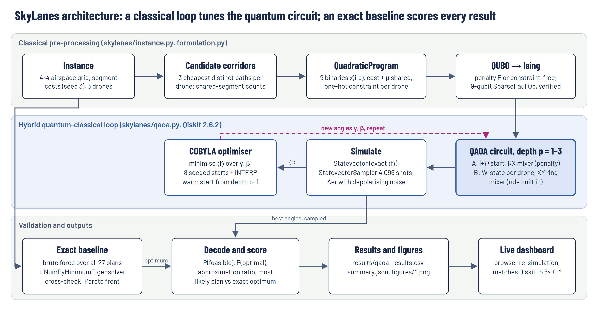
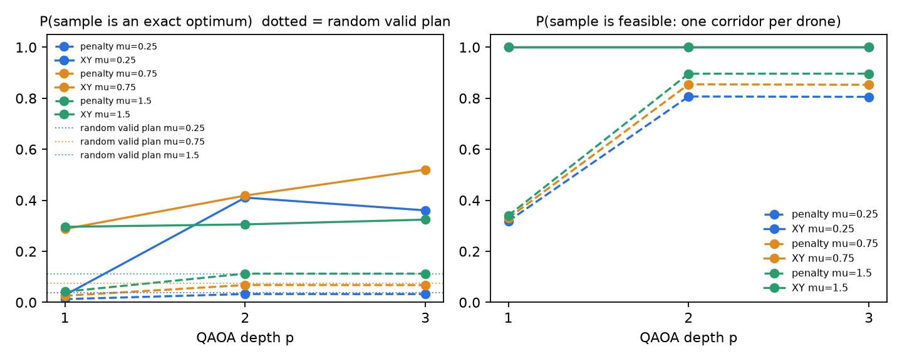

# SkyLanes: conflict-aware drone corridor routing with QAOA

**IBM Qiskit Hackathon: The Quantum Optimization Challenge. Domain: UAVs & Robotics.**

After a storm, three inspection drones must each fly one of three candidate corridors. The dispatcher wants **low total battery use** and **few shared airspace segments**, two goals that pull against each other, and every drone's choice affects the others. SkyLanes encodes the joint choice as a **9-qubit QUBO**, solves it with **QAOA in Qiskit** in two versions (the one-route rule as a penalty, and the rule built into the circuit with an **XY mixer**), and scores every quantum result against an **exact classical baseline**.

## Deliverables

| Deliverable | Where |
|---|---|
| Working, reproducible Qiskit code | this repository (run it with [How to run](#how-to-run)) |
| Report (.docx) with results, classical/exact comparison and limitations | [`SkyLanes_Report.docx`](SkyLanes_Report.docx) |
| Architecture diagram (also in the report) | [`SkyLanes_Architecture.png`](SkyLanes_Architecture.png) and vector [`SkyLanes_Architecture.pdf`](SkyLanes_Architecture.pdf) |
| 3-minute video pitch and demo | _Google Drive link: to be added_ |
| Live interactive dashboard | https://skylanes-dashboard.vercel.app |



## Results at a glance

9 qubits, noise-free simulation, QAOA depth p = 3. Ranges cover the trade-off weights μ = 0.25, 0.75 and 1.5.

| | Exact brute force | Penalty QAOA | XY-mixer QAOA |
|---|---|---|---|
| Chance a single shot is an exact best plan | 100% | 3–11% | **32–52%** |
| Against picking a random valid plan | n/a | 0.9–1.0× (no better) | **2.9–9.7× better** |
| Shots obeying "one route per drone" | 100% | 81–90% | 100% |
| Exact optimum found among 4,096 shots | n/a | yes, all 3 settings | yes, all 3 settings |
| Time | 0.09 ms | 31–45 s of tuning | 80–127 s of tuning |

- **Correctness:** the Ising Hamiltonian reproduces the QUBO on all 512 bitstrings with zero error, and brute force agrees with Qiskit's `NumPyMinimumEigensolver` on every optimum.
- **Noise (Qiskit Aer):** at 1% two-qubit gate error both variants fall to about 3% best-plan shots. Compiling for a linear chain of qubits adds 2.4–2.7× more CNOTs.
- **12 qubits (4 drones):** the XY version stays 4.4× better than random, but the absolute success rate drops to 5.4%.
- **Honest verdict:** no quantum speed-up is claimed. At this size classical search is exact and far faster. Section 7 of the report covers the limitations.

<p align="center"></p>

## How to run

Tested on **Windows 11 with Python 3.12.13**. The commands for macOS and Linux are given too. Every command runs from the repository root.

### 1. Prerequisites

- **Python 3.12** ([python.org](https://www.python.org/downloads/)). Python 3.13 and 3.14 are not tested; Qiskit Aer may not have wheels for them yet.
- **Git.**
- *Optional:* Node.js 18 or newer, only for the dashboard check in step 7 and the report rebuild.

### 2. Get the code

```bash
git clone https://github.com/Xaryaab/Qiskit_Hackathon.git
```

```bash
cd Qiskit_Hackathon
```

### 3. Create a virtual environment and install the pinned packages

**Windows (PowerShell):**

```powershell
py -3.12 -m venv .venv
```

```powershell
.venv\Scripts\Activate.ps1
```

If PowerShell refuses to run the activation script, skip activation and replace `python` with `.venv\Scripts\python.exe` in every command below.

**macOS / Linux:**

```bash
python3.12 -m venv .venv
```

```bash
source .venv/bin/activate
```

**Then, on any system:**

```bash
python -m pip install --upgrade pip
```

```bash
python -m pip install -r requirements.txt
```

This installs qiskit 2.6.2, qiskit-optimization 0.7.0, qiskit-algorithms 0.4.0, qiskit-aer 0.18.2, SciPy and matplotlib at the exact versions used for the results.

### 4. Run the exact classical baseline (under 1 second, standard library only)

```bash
python baseline_bruteforce.py
```

Expected end of the output:

```text
Feasible assignments: 27 (of 2^9 = 512 bitstrings)
Pareto front (total cost, conflicts): [(19, 4), (20, 2), (21, 1), (22, 0)]
...
  mu=1.5   optimum=22.0   optimal assignments (corridor per drone, cost, conflicts): [((1, 3, 2), 22, 0), ((2, 1, 2), 22, 0), ((3, 1, 2), 22, 0)]
```

### 5. Run QAOA

**Quick check** (about 1–2 minutes; 79 s on the test machine: μ = 1.5, depth 1–2, both mixers, shots and the noise study):

```bash
python -m skylanes.experiments --quick
```

Each line compares QAOA with the exact answer. Expect output like:

```text
mu=1.5: exact optimum 22.0 via [[1, 3, 2], [2, 1, 2], [3, 1, 2]]; Ising mapping error 0.00e+00; NumPy eigensolver {'fval': 22.0, 'choice': [2, 1, 2]}
  q=9 mu=1.5  x  p=1  P(feasible)=0.110  P(optimal)=0.017  ratio=0.631  best=[1, 3, 1] (...s)
  q=9 mu=1.5  x  p=2  P(feasible)=0.896  P(optimal)=0.112  ratio=0.624  best=[2, 1, 2] (...s)
  q=9 mu=1.5  xy p=1  P(feasible)=1.000  P(optimal)=0.296  ratio=0.860  best=[2, 1, 2] (...s)
  q=9 mu=1.5  xy p=2  P(feasible)=1.000  P(optimal)=0.303  ratio=0.889  best=[2, 1, 2] (...s)
noise study (XY-mixer QAOA, linear-chain hardware):
  noise 2q-error=0.0    P(feasible)=1.000 P(optimal)=0.312
  noise 2q-error=0.002  P(feasible)=0.702 P(optimal)=0.213
  noise 2q-error=0.01   P(feasible)=0.221 P(optimal)=0.053
```

**Full experiment grid** (about 20 minutes: μ = 0.25, 0.75 and 1.5, depth 1–3, both mixers, shots, Aer noise study, 12-qubit scaling run):

```bash
python -m skylanes.experiments
```

Results go to `results/qaoa_results.csv` and `results/summary.json`. The committed `results/` folder holds the output of this full run. `--quick` overwrites it with the smaller run, so use `git checkout results` to restore it afterwards.

### 6. Make the figures

```bash
python -m skylanes.plots
```

This writes `routes.png`, `pareto.png`, `depth.png` and `histogram.png` to `results/figures/`.

### 7. Optional: the dashboard

The dashboard is a static web page. Its in-browser simulator runs the same circuits as the Qiskit code.

Export the Qiskit results and circuits for it:

```bash
python dashboard/export_data.py
```

Check that the browser simulator reproduces Qiskit's probabilities (needs Node.js); it prints `18/18 match` with the committed full results, or `4/4 match` after a `--quick` run:

```bash
node dashboard/test_sim.mjs
```

Serve it locally, then open http://localhost:8000 in a browser:

```bash
python -m http.server 8000 --directory dashboard/site
```

The same page is live at https://skylanes-dashboard.vercel.app.

### 8. Optional: rebuild the report and the diagram

```bash
cd report
```

```bash
npm install
```

```bash
node build_report.js
```

This regenerates `SkyLanes_Report.docx` from the recorded results. `report/architecture.html` is the diagram's source; `report/render_diagram.py` renders it to PNG (needs Playwright).

## What each file does

| Path | Purpose |
|---|---|
| `baseline_bruteforce.py` | Exact classical reference: all 27 plans, Pareto front, weighted optima |
| `skylanes/instance.py` | 4×4 airspace grid, drones, candidate corridors, costs, shared segments |
| `skylanes/exact.py` | Brute-force enumeration, Pareto front, weighted optimum |
| `skylanes/formulation.py` | `QuadraticProgram` → QUBO → Ising, bitstring energies, mapping check |
| `skylanes/qaoa.py` | QAOA circuits (penalty / XY mixer) and the seeded COBYLA optimiser |
| `skylanes/metrics.py` | P(feasible), P(optimal), approximation ratio, most likely plan |
| `skylanes/experiments.py` | Full experiment grid, shots, Aer noise study, 12-qubit scaling |
| `skylanes/plots.py` | Figures for the report |
| `results/` | Recorded results (CSV, JSON, figures) behind every number in the report |
| `dashboard/` | Static dashboard, Qiskit data exporter, simulator check against Qiskit |
| `report/` | Report builder (`build_report.js`) and architecture diagram source |
| `video/` | Pipeline that made the demo video: script, Kokoro voice-over, dashboard capture, Remotion animation |
| `PROJECT_PLAN.md` | The original plan, kept for reference |

## Reproducibility notes

- **Deterministic:** instance seed 3, optimiser seeds 7 + p, sampler, transpiler and Aer seed 7.
- **Built-in checks:** every run re-checks the Ising mapping against the QUBO on all bitstrings and cross-checks brute force against `NumPyMinimumEigensolver`.
- **Timings:** QAOA timings depend on the machine. The probabilities and plans do not.

## Troubleshooting

- **`No matching distribution` while installing:** use Python 3.12, not 3.13 or 3.14.
- **PowerShell won't activate the environment:** call `.venv\Scripts\python.exe` directly instead of `python`.
- **The full run is slow:** use `--quick` first. The full grid simulates about 50,000 circuits.
